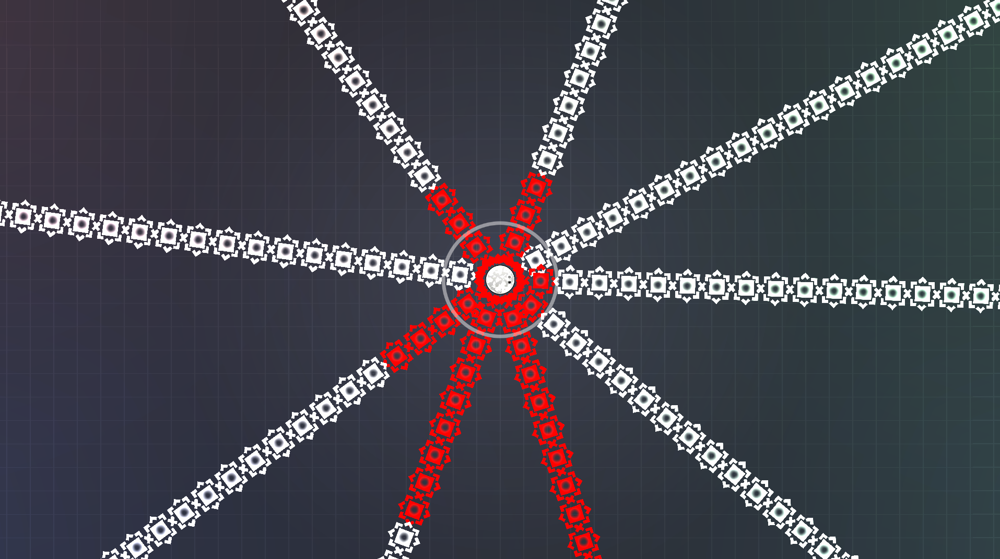
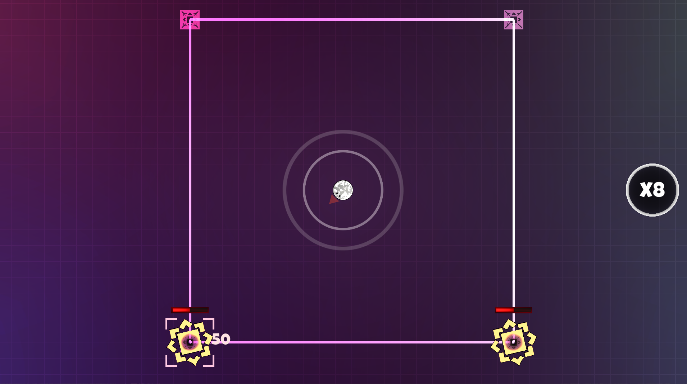
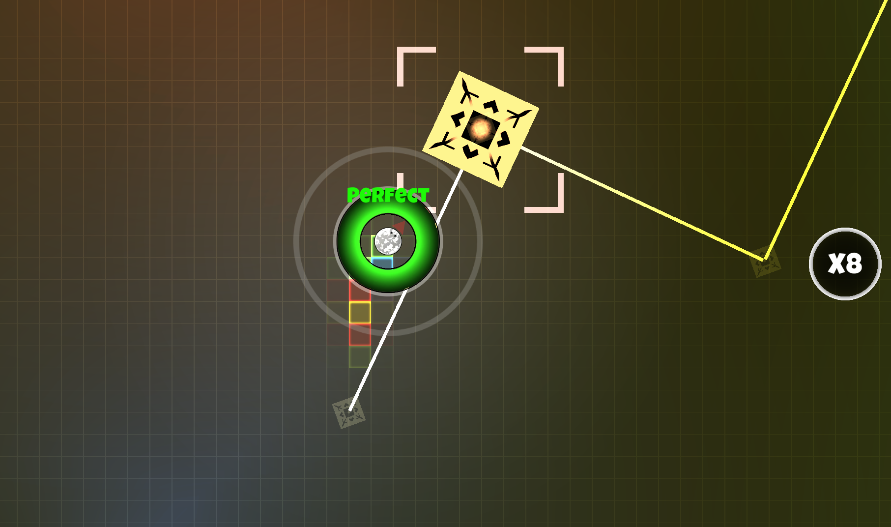
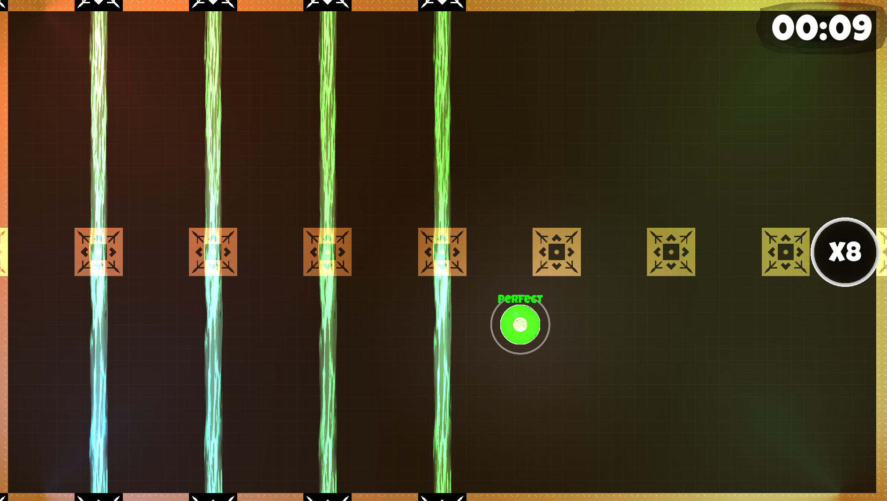
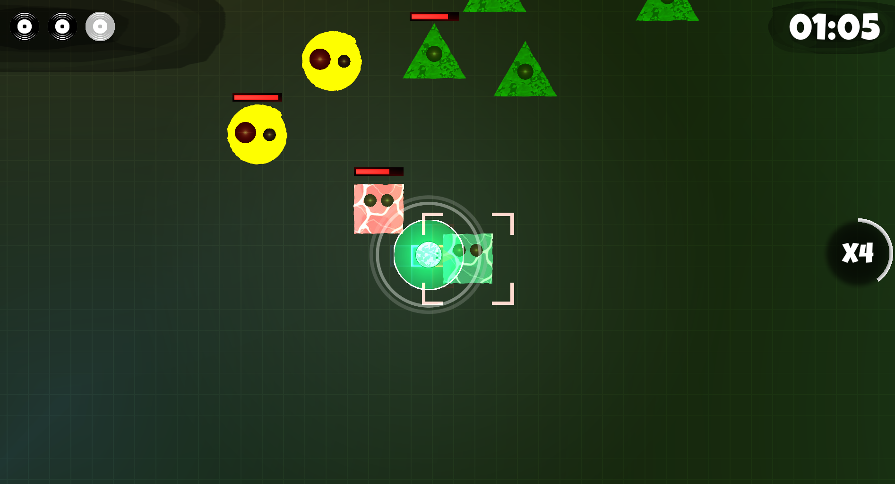

# Beat Slap

  

**Beat Slap** is a top-down 2D rhythm-action game developed as a two-person university project in 2022.

The project reached a playable demo and combines real-time combat with rhythm-driven gameplay: player actions and abilities are evaluated against the music timing, while audiovisual feedback reinforces successful hits and combos.

> **Portfolio note:** This repository is a curated showcase of my contributions to the original collaborative project. It is intentionally not a complete copy of the historical Unity repository.

## Project Overview

The goal was to make the soundtrack part of the actual gameplay rather than only background music. Combat actions, player abilities, timing feedback and parts of the game presentation were connected to the current beat.

The demo included several player abilities, enemies, combat encounters and a tutorial/progression structure built around rhythm mechanics.

## Team Project & My Contributions

Beat Slap was developed together with another student.

My primary responsibilities were:

- **FMOD integration**
- **Music production and implementation**
- **Sound design**
- **Rhythm / beat integration into gameplay**
- **Early beat-synchronized player ability logic**
- Timing and combo-related audiovisual feedback
- Parts of the visual presentation, including rhythm-reactive effects

My teammate was primarily responsible for areas such as the later **enemy AI**, the **state-machine architecture** and much of the final **projectile architecture**.

Some systems evolved collaboratively over the course of the project. The curated source in this repository therefore distinguishes between code that is strongly attributable to my work and shared code included only as technical context.

## Technical Highlights

### FMOD & Dynamic Music

The project used **FMOD Studio** for music playback, beat/marker callbacks and dynamic music control.

The music system could manipulate individual musical layers and parameters during gameplay, including bass, percussion, piano, strings and other elements.

### Rhythm-Synchronized Abilities

Player abilities were connected to a timing window around the current beat.

An early version of the ability system that I implemented:

- reacted to Unity Input System callback events,
- tracked timing relative to the beat,
- classified successful and failed inputs,
- maintained combo state,
- and triggered abilities when the input timing was valid.

The ability architecture was later substantially refactored as part of the collaborative project.

### Audio Feedback & Combos

Successful rhythm play was reinforced through audio feedback. Different combo levels could trigger different sounds, making the music and gameplay feedback work together.

## Curated Source

The repository separates my contributions from shared project context:

| Area | File | Context |
| --- | --- | --- |
| Dynamic music | `source/robin/audio/MusicManager.cs` | Primarily my implementation and later development |
| Combo audio | `source/robin/audio/AudioComboPlayer.cs` | Added by me |
| Beat-synchronized abilities | `source/robin/abilities/PlayerAbilityActivator.cs` | Historical snapshot from one of my own commits |
| FMOD beat callbacks | `source/shared-context/rhythm/BeatSystem.cs` | Collaborative system, included for context |

See **[source/README.md](source/README.md)** for provenance details.

## Tech Stack

| Area | Technologies |
| --- | --- |
| Engine | Unity |
| Language | C# |
| Audio | FMOD Studio |
| Input | Unity Input System |
| Game Type | Top-down 2D rhythm action |
| Architecture | ScriptableObjects, event/channel communication, component-based gameplay systems |

## Screenshots & Gameplay

  
  

  
  

The screenshots above are archived material from the playable university demo.

## Demo

A playable archived Windows build is available through the **[v1.0-demo GitHub Release](https://github.com/robin-schneider-dev/beat-slap/releases/tag/v1.0-demo)**.

Download `beat-slap-windows-demo.zip`, extract the archive and start the included Windows executable.

## Project Status

**Completed university demo / archived.**

The public repository focuses on portfolio-relevant source code and intentionally excludes the full historical Unity project, third-party packages and unrelated team-owned implementation details.
